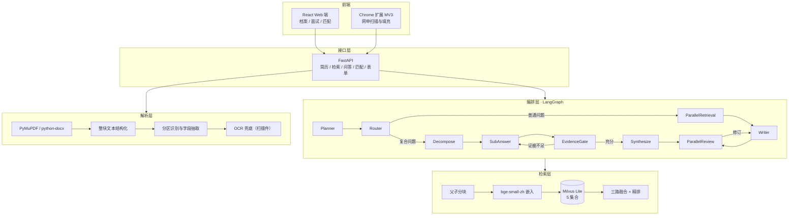

<div align="center">

# ResuMatch AI

**基于 LangGraph 的多 Agent 协作 AI 求职面试系统**

从简历解析、网申填充、岗位匹配到面试对练，把校招求职的全链路串成一条可复现的自动化流水线。

[](https://github.com/niurou123/ResuMatch-AI/actions/workflows/ci.yml)
[](https://www.python.org/)
[](https://fastapi.tiangolo.com/)
[](https://langchain-ai.github.io/langgraph/)
[](https://react.dev/)
[](tests/)
[](LICENSE)

</div>

---

## 目录

- [项目简介](#项目简介)
- [核心特性](#核心特性)
- [系统架构](#系统架构)
- [快速开始](#快速开始)
- [评测结果](#评测结果)
- [项目结构](#项目结构)
- [API 概览](#api-概览)
- [技术栈](#技术栈)
- [开发与测试](#开发与测试)
- [文档索引](#文档索引)
- [路线图](#路线图)
- [贡献与许可](#贡献与许可)

## 项目简介

校招求职存在三个低效环节：同一份信息在多个平台**重复填报**；简历与岗位要求之间**缺少量化匹配依据**；
面试回答**缺少事实细节**。大语言模型可以缓解这些问题，但其幻觉与不可溯源在求职这类对事实准确性要求
极高的场景中会被显著放大。

本项目把 **检索增强生成** 与 **多 Agent 协作** 结合起来解决上述问题，并在设计上明确两条底线：

- **解析不改写**：简历解析全程使用规则，不使用大模型改写内容，每个字段标注来源行号与置信度；
- **生成不编造**：写作环节受引用约束，回答中的数字必须能回溯到简历原文，并由规则化检测校验。

> 本项目为本科毕业设计作品，同时作为可复现的工程样本维护。

## 核心特性

| 能力 | 说明 |
|---|---|
| **简历解析** | 支持 PDF / DOCX / MD / TXT；分区识别 + 字段抽取 + 来源标注；扫描件走 OCR 兜底 |
| **结构化档案** | 基本信息 / 教育 / 实习 / 项目 / 技能 / 成果，可在 Web 端逐字段校对 |
| **检索增强生成** | 父子分块、中文嵌入、三路并行检索（关键词 / 语义 / 知识图谱）+ 融合投票 + 交叉编码器精排 |
| **多 Agent 工作流** | LangGraph 9 节点：规划 → 路由 → 分解 / 检索 → 写作 → 评审 → 条件修订 |
| **复合问题分解** | 比较/并列类问题自动拆成子问题并发作答，再由证据闸门触发补充检索，最后整合 |
| **岗位匹配** | 岗位需求抽取 + 项目三维打分（技术交集 / 年限 / 复杂度），输出可解释依据 |
| **网申填充** | Chrome MV3 扩展扫描表单、分区感知映射、下拉别名匹配、一键填充与结果反馈 |
| **可复现评测** | 六组实验脚本、消融方案与评测数据，全部可一键复跑 |

## 系统架构



## 快速开始

### 前置要求

- Python **3.10+**（开发环境 3.11）
- Node.js **20+**（前端与扩展构建）
- Chrome / Edge（加载扩展时）

### 安装与启动

```bash
# 1. 安装后端依赖
python -m venv .venv
.venv\Scripts\activate          # Windows；Linux/macOS 用 source .venv/bin/activate
pip install -r requirements.txt

# 2. 配置环境（只需填 API Key）
copy .env.example .env          # Linux/macOS: cp .env.example .env

# 3. 启动后端（默认 http://localhost:8721）
python -m src.api.main

# 4. 启动前端（新终端，默认 http://localhost:5173）
cd frontend
npm install
npm run dev
```

后端冷启动约 60 秒（需加载中文嵌入与精排模型），日志出现 `Application startup complete` 即可访问。

### 加载 Chrome 扩展

1. 打开 `chrome://extensions`，开启右上角「开发者模式」
2. 点击「加载已解压的扩展程序」，选择本仓库的 `extension/` 目录
3. 在网申页面点击扩展图标 → 「扫描页面」→「一键填充」

### 使用流程

```
上传简历 → 校对档案 → JD 匹配 / 面试对练 → 网申一键填充
```

## 评测结果

六组实验均可在本地一键复跑，脚本见 `scripts/`，原始结果见 `data/eval/`。

| 实验 | 设置 | 主要结果 |
|---|---|---|
| 字段提取准确率 | 12 份合成简历，对照种子真值 | 字段级准确率 **100%**，技能 P/R/F1 = 1.000 |
| 解析鲁棒性 | 48 份公开真实语料（CC0 / MIT，含 8 份扫描件） | 文本提取 **100%**，结构化 **83.3%** |
| 检索质量与消融 | 223 道标注问题，六模式消融 | Recall@5 **0.876**，MRR **0.780**，nDCG@5 **0.809** |
| 生成质量（三档对照） | 单次调用 / 快速 / 完整工作流 | 快速档 6/6 有效且 STAR 100%，约 12 s |
| 流水线延迟 | 全量工作流，修订轮次收敛为 1 | 耗时中位 **27.2 s**（收敛前 76.9 s，−62%） |
| 复合问题分解 | 5 道多方面问题，规则计算方面覆盖率 | **93.3% → 100%**，与全文直送持平 |
| 网申表单填充 | 85 个字段、5 类站点夹具 | 覆盖率 **88.2%**，下拉别名 10/10，空值不编造 5/5 |

**关于指标的说明（重要）**

- 字段提取的 100% 反映的是**规则对规范排版文本的保真度**，不等同于真实世界准确率；
- 消融实验显示假设文档检索与多查询在小语料下收益趋零、精排带来显著时延——这类**负面结果**同样如实记录；
- 生成质量的指标是规则化检测（STAR 结构、数字可回溯），以避免模型自评造成的循环论证。

## 项目结构

```
ResuMatch-AI/
├── src/
│   ├── api/            # FastAPI 路由与依赖
│   ├── agents/         # LangGraph 工作流：planner/router/decomposer/retriever/writer/reviewer
│   ├── core/           # 配置、LLM 客户端、提示词
│   ├── features/       # 自我介绍、岗位匹配等业务能力
│   └── rag/            # 解析器、分块、嵌入、向量库、精排
├── frontend/           # React 19 + Vite + TypeScript + Tailwind
├── extension/          # Chrome MV3 网申填充扩展
├── scripts/            # 评测、论文与答辩材料生成工具
├── tests/              # pytest 测试（36 项）
├── data/eval/          # 可复现评测集与实验报告
├── SPEC.md             # 技术规格与变更日志
├── BUG_LOG.md          # 缺陷档案（34 个案例，含根因与验证）
└── TECH_STACK_ANALYSIS.md  # 技术选型对比
```

## API 概览

| 分组 | 端点 | 说明 |
|---|---|---|
| 简历 | `POST /api/v1/resume/upload` | 上传并解析简历 |
| 档案 | `GET/PUT /api/v1/profile` | 读取与更新结构化档案 |
| 问答 | `POST /api/v1/interview/ask` | 面试问答（支持流式） |
| 对练 | `POST /api/v1/interview/practice` | 面试官 / 候选人双向对练 |
| 匹配 | `POST /api/v1/jd/match` | 岗位需求抽取与项目匹配 |
| 表单 | `POST /api/v1/form/map` | 表单字段映射 |
| 系统 | `GET /api/v1/health`、`/system/info` | 健康检查与运行信息 |

完整定义见启动后的 `/docs`（Swagger UI）。

## 技术栈

| 层次 | 选型 |
|---|---|
| 编排 | LangGraph（9 节点有向图 + 条件边回环） |
| 后端 | FastAPI 0.104 · Uvicorn · Pydantic |
| 检索 | Milvus Lite（嵌入式）· bge-small-zh（512 维）· bge-reranker-base |
| 解析 | PyMuPDF · python-docx · RapidOCR（扫描件兜底） |
| 前端 | React 19 · Vite 8 · TypeScript · Tailwind CSS 3.4 |
| 扩展 | Chrome Manifest V3 |
| 模型 | DeepSeek（OpenAI 兼容端点） |

## 开发与测试

```bash
# 单元测试
pytest -q

# 字段提取评测（零 LLM 消耗）
python scripts/eval_extraction.py

# 检索质量与消融（零 LLM 消耗）
python scripts/eval_retrieval.py

# 生成质量三档对照（消耗 LLM 调用）
python scripts/eval_generation_e2e.py --n 6 --mode all

# 复合问题分解 A/B
python scripts/eval_decomposition.py --n 5 --mode both

# 解析鲁棒性（合成 vs 外部语料）
python scripts/fetch_external_resumes.py --text 40 --pdf 8
python scripts/eval_robustness.py

# 表单填充覆盖率（无需浏览器）
node scripts/eval_form_fill.js

# 前端类型检查与构建
cd frontend && npx tsc --noEmit && npm run build
```

## 文档索引

| 文档 | 内容 |
|---|---|
| [SPEC.md](SPEC.md) | 技术规格、模块契约、v1–v34 变更日志 |
| [BUG_LOG.md](BUG_LOG.md) | 34 个缺陷案例：现象 / 根因 / 方案 / 验证 |
| [TECH_STACK_ANALYSIS.md](TECH_STACK_ANALYSIS.md) | 关键技术选型的横向对比与取舍 |
| [CONTRIBUTING.md](CONTRIBUTING.md) | 提交规范、分支策略、协作流程 |
| [SECURITY.md](SECURITY.md) | 安全策略与漏洞报告方式 |
| [CHANGELOG.md](CHANGELOG.md) | 版本演进记录 |

## 路线图

- [x] 规则化简历解析与来源标注
- [x] 三路并行检索与融合投票
- [x] 多 Agent 工作流与条件修订
- [x] 网申表单扫描与一键填充
- [x] 六组可复现评测与消融实验
- [x] 复合问题分解与证据闸门回环
- [x] 扫描件 OCR 兜底
- [ ] 多语言分区规则（当前支持中英文）
- [ ] OCR 异步化（当前同步处理，单份数十秒）
- [x] 写作节点最短长度保护（残答防护，v35）

## 贡献与许可

欢迎提交 Issue 与 Pull Request，请先阅读 [CONTRIBUTING.md](CONTRIBUTING.md)。

- **许可证**：[MIT](LICENSE)
- **数据与隐私**：仓库不包含任何真实个人简历；`data/eval/` 下的语料均为程序化生成，
  或来自 CC0 / MIT 授权的公开数据集
- **学术用途**：本项目为本科毕业设计成果，请勿直接用于商业用途
